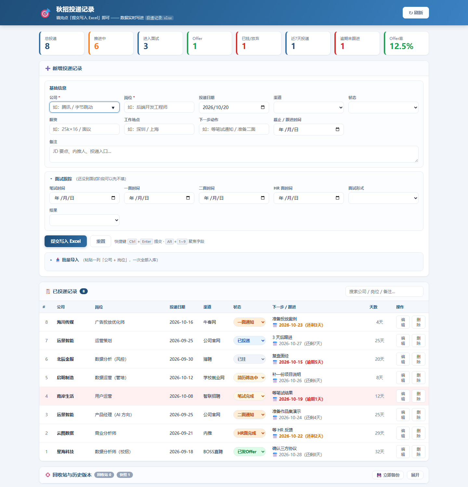

# 秋招投递管理系统 · Job Application Tracker

一个**本地优先**的求职投递跟踪工具：浏览器里填「公司 + 岗位」，数据立刻写进同目录的 Excel；四层数据保护，保证误操作可回滚。

> 个人项目（2026.09 起），日常在用：单机维护 88 条投递记录、146 份自动快照。
> 本项目与 AI Agent（DeepSeek Harness / deepseek-v4 系列）协作完成：需求、字段与验收标准由我定义，代码实现与排查由 Agent 执行，详见 [与 AI 的协作方式](#与-ai-的协作方式)。

---



<sub>截图为演示数据（虚构公司与岗位），非真实投递记录。</sub>

---

## 为什么做

秋招同时投 80 多家公司，公司 / 岗位 / 笔试时间 / HR 面时间散落在邮箱、招聘 App 和聊天记录里，
靠 Excel 手填容易出现三类问题：**漏跟进、错过截止、表格被自己改坏**。

目标很收敛：

1. 录入要快 —— 打开就填，提交即落盘，不引入任何账号体系；
2. 状态要一眼看见 —— 已投递 / 筛选中 / 笔试 / 面试 / Offer / 挂了，按颜色区分；
3. 数据绝不能丢 —— 每一次写入都可回滚，删除不销毁。

## 功能

| 模块 | 说明 |
|---|---|
| 网页录入台 | 单文件 HTTP 服务，浏览器打开即用；下拉候选、自动填今天日期、`Ctrl+Enter` 提交、`Alt+1~9` 跳字段 |
| 主表（19 列） | 公司、岗位、投递日期、渠道、薪资、地点、状态、下一步动作、截止/跟进时间、笔试/一面/二面/HR 面时间、面试形式、结果 + 两列自动公式（投递天数、跟进提醒） |
| 自动视觉提示 | 条件格式按状态整行变色；**截止已过且未出结果 → 整行变红** |
| 统计看板 | 总投递 / 推进中 / 进面 / Offer / 已挂 / 近 7 天 / 今日 / 逾期未跟进 / Offer 转化率，全部公式实时更新 |
| 批量导入 | 粘贴一列「公司 + 岗位」即可入库；兼容空格、中英文逗号、Tab、分号、竖线、`/`、`-` 分隔，行尾可带日期，自动去重 |
| 结构化导入 | `POST /api/bulk` 接收整行字段（渠道、状态、下一步动作、截止时间），用于把截图 / 聊天记录转成表格 |
| 回收站 | 删除 = 把整行挪进 `已删除` 工作表，网页里一键还原 |
| 历史版本 | 每次写入前自动快照到 `backups/`（保留 400 份），可整表回滚；回滚前再存一份，回滚错了也能退回来 |

## 技术栈

- **Python 3.8+**，唯一第三方依赖 `openpyxl`
- **`http.server.ThreadingHTTPServer`**（无 Flask / Django）+ 原生 HTML/CSS/JS，零构建
- 数据即文件：`投递记录.xlsx`（4 张工作表：投递记录 / 选项 / 统计 / 已删除）

```
app.py            # 单文件服务：HTTP 路由 + Excel 读写 + 备份/回滚 + 条件格式
web/              # index.html / style.css / app.js
使用说明.md         # 面向使用者的完整操作与排错手册
docs/             # AI 协作规则示例（把"删除前必须确认"固化成硬约束）
```

启动：双击 `启动录入.bat`（或 `python app.py`），浏览器自动打开 <http://127.0.0.1:8760>，端口占用会自动顺延。

API：`/api/data` `/api/add` `/api/update` `/api/delete` `/api/bulk` `/api/backup` `/api/restore` `/api/rebuild` `/api/ping`

## 数据保护设计（这个项目的重点）

第一版有过一次真实事故：Agent 在未确认文件内容的情况下删除了主表，记录无法恢复。
之后把"防丢"做成了架构的一部分：

| 层 | 机制 | 解决问题 |
|---|---|---|
| 1 | 每次写 / 改 / 删前自动快照，保留 400 份 | 任何一次错误写入都能定位到时间点 |
| 2 | 删除改为软删除（进 `已删除` 表） | 单条误删可还原，不依赖备份 |
| 3 | 整表回滚，且回滚前再快照 | 回滚本身也可撤销 |
| 4 | `docs/AI协作规则示例_AGENTS.md` 硬约束 + 自检脚本安全闸（表中非空即拒绝运行，退出码 3） | 让"删除前必须确认"变成 Agent 可见的规则，而不是口头约定 |

## 与 AI 的协作方式

- **我负责**：需求定义、19 个字段与状态机、跟进提醒与统计口径、验收标准；逐轮实测并提改进（状态列表内联修改、逾期提醒、批量导入、回收站与历史版本）。
- **Agent 负责**：代码实现（服务端路由、openpyxl 样式 / 数据验证 / 条件格式、前端交互）、bug 定位、脚本自检。
- **模型选择**：DeepSeek Harness 桌面 Agent + deepseek-v4 系列（含视觉模型）。选它而不是纯对话式 AI 的理由：① 有本地文件与命令权限，能交付可运行程序而非代码片段；② 长上下文可一次读完项目文档；③ 支持把规则固化成 `AGENTS.md`，避免同类错误重复发生；④ 视觉模型可直接把投递截图转成结构化表格。

## 已知限制

- 单机单用户；Excel 被 Excel 程序独占打开时写入失败，会提示重试（浏览器内已填内容不丢）。
- 快照是全表复制，记录量很大时应改成增量或压缩归档。
- 时区与日期按本机处理，跨时区投递需要手动核对。

## Roadmap

- [ ] 邮件 / 短信提醒（逾期与面试前一天）
- [ ] 多视图（看板 / 时间线）与按渠道的转化率对比
- [ ] 从招聘平台邮件自动解析投递记录
